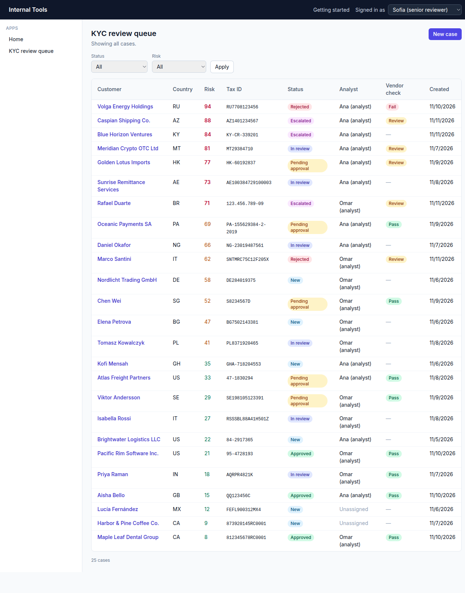
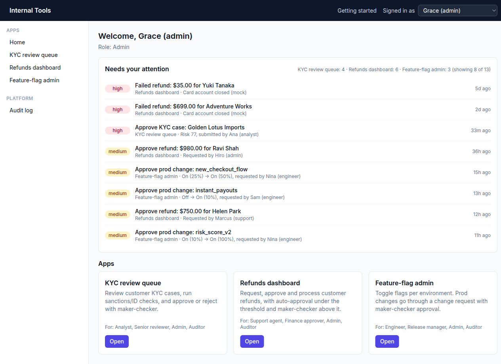
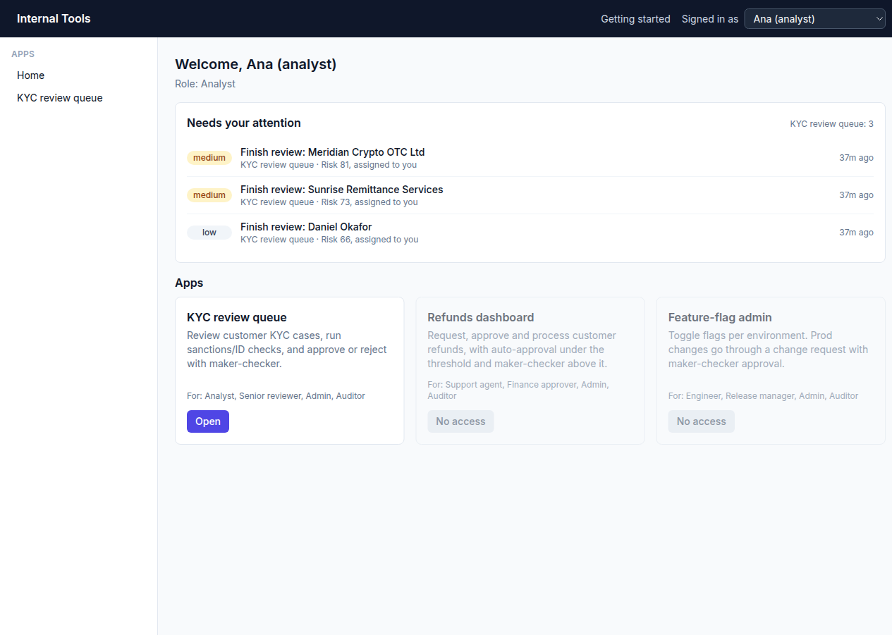
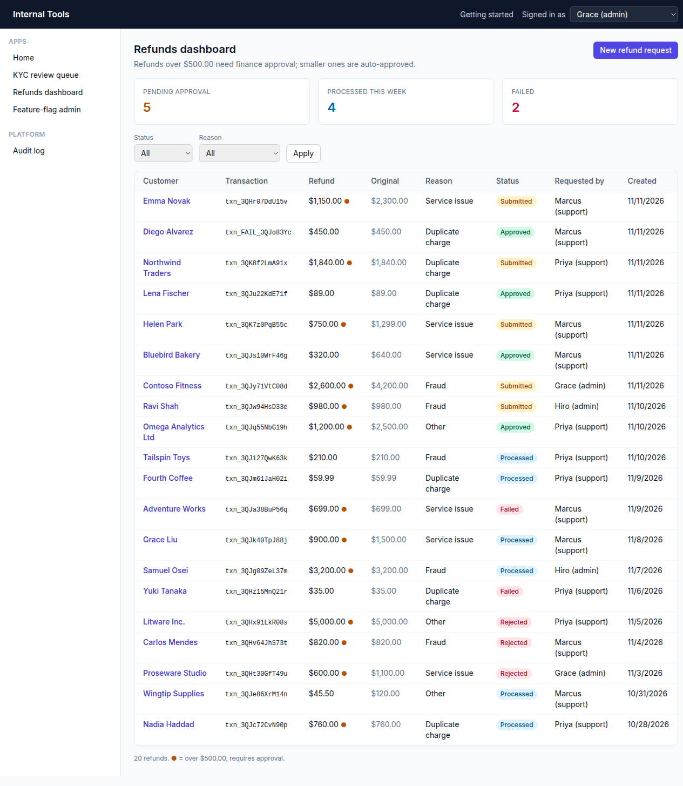
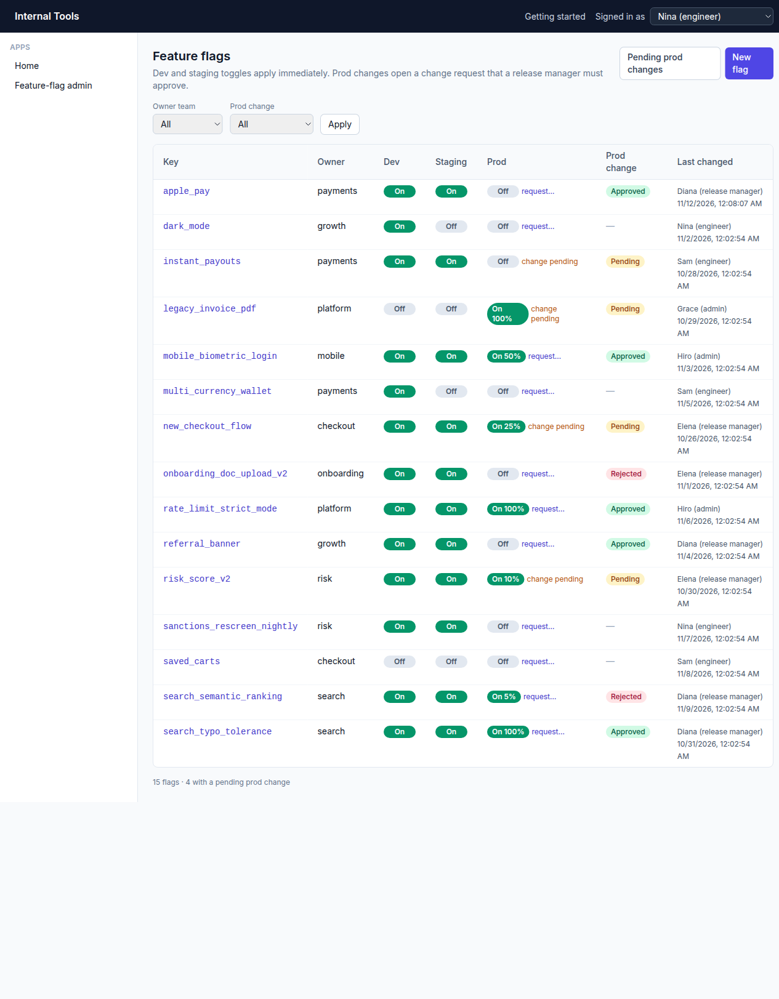
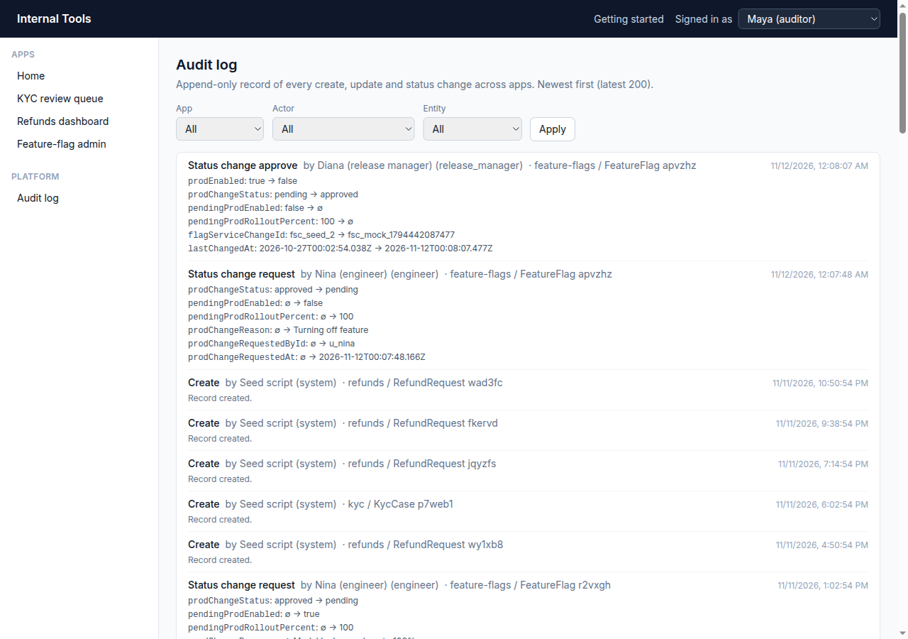

# Internal Tools (prototype)

A proof of concept showing that the internal tools now built in Microsoft Power Apps (KYC review queue, refunds dashboard, feature-flag admin, and 10+ more) can live in their own codebase on a shared foundation that gives every app the governance Power Apps provides: **access control, audit logging, approvals and integrations**.

This repo contains the foundation plus three apps: the **KYC review queue**, the **Refunds dashboard** and the **Feature-flag admin**. New apps are added with [`docs/playbooks/new-internal-app.md`](docs/playbooks/new-internal-app.md).

> Prototype, not production software. See [Out of scope](#out-of-scope).

## Run it

Requires Node 20+ (tested on Node 22).

```bash
npm install
npm run setup     # creates .env from .env.example, runs migrations, seeds data
npm run dev       # http://localhost:3000
```

Other scripts: `npm test` (Vitest, uses a separate `prisma/test.db`), `npm run lint`, `npm run typecheck`, `npm run db:reset` (wipe and re-seed).

Use the **Signed in as** switcher in the header to change user. Seeded users (two per role):

| Role | Users | What they see in KYC |
|---|---|---|
| analyst | Ana, Omar | Only cases assigned to them; tax ID masked; can start review, run vendor check, add notes, submit a recommendation, escalate |
| senior_reviewer | Sofia, Raj | All cases; tax ID visible; create cases ("New case"); approve or reject pending cases (not ones they submitted); send back; resume escalated |
| admin | Grace, Hiro | Everything plus the audit log and "Simulate new signup"; still bound by maker-checker |
| auditor | Maya, Leo | Read-only access to all cases (tax ID masked) and the audit log |
| engineer | Nina, Sam | No KYC access (Feature-flag admin only, see below) |
| release_manager | Elena, Diana | No KYC access (Feature-flag admin only, see below) |



Demo tip: open "Chen Wei" as Sofia. She submitted it, so Approve is disabled. Switch to Raj and approve it, then check the case history and **Audit log**. The mock Slack message prints in the `npm run dev` console.

## Launcher and Getting started



- **Launcher (`/`)**: one card per registered app with its description, the roles it's for and an **Open** button. Apps the current role can't use are greyed out with "No access" (below, as Ana the analyst). Built entirely from the registry in `src/apps/index.ts`, so new apps appear automatically.
- **Needs your attention**: items the current user can act on right now across all apps, highest priority then oldest first (top 8, with a count per app). Each app declares an `attention` query; items are read through the data helpers and filtered with the same permission, status and maker-checker checks the server enforces, so your own submissions never appear. "You're all caught up" when there is nothing.

  | App | Item | Who sees it | Priority |
  |---|---|---|---|
  | KYC | Pending approval | Senior reviewers and admins who didn't submit it | High if risk ≥ 70, else medium |
  | KYC | In review, assigned to you | The assigned analyst | Medium if risk ≥ 70, else low |
  | Refunds | Over $500, pending approval | Finance approvers and admins who didn't request it | Medium |
  | Refunds | Failed | Finance approvers and admins | High |
  | Feature flags | Pending prod change | Release managers and admins who didn't request it | Medium |

- **Getting started (`/guide`, header link)**: what the platform is, how the **Signed in as** switcher works, a demo path per app (which user to switch to and what to try) and how governance works. A dismissible "New here? Start with the guide" banner shows on first visit (remembered in the browser).
- **"?" hints** next to key actions (Submit for approval, Approve, Process refund, Request prod change) explain what happens and who can do it. "Who" is read from the workflow, so it matches what the server enforces.



### Creating cases

- **New case form** (`/apps/kyc/new`, admin and senior reviewer): customer name, country, tax ID, risk score (0–100), assigned analyst, notes. Validated server-side and audited as `create`.
- **Automated intake** (`POST /api/kyc/intake`): simulates the onboarding system. Creates a `new` case, runs the mock vendor check automatically, and audits it as `intake` by the "Onboarding system" service account:
  ```bash
  curl -X POST localhost:3000/api/kyc/intake \
    -H "Authorization: Bearer $(grep ONBOARDING_SERVICE_TOKEN .env | cut -d'"' -f2)" \
    -H "Content-Type: application/json" \
    -d '{"customerName":"Nordic Pay AB","country":"SE","taxId":"SE556677889901","riskScore":35}'
  ```
  Admins can click **Simulate new signup** on the queue to send randomized data through the same endpoint with their session.

### Refunds dashboard



`/apps/refunds`: summary tiles (pending approval, processed in the last 7 days, failed) above a table filterable by status and reason, a detail page with role- and status-dependent actions plus audit history, and a **New refund request** form built on the shared create pattern.

- Statuses: `submitted → approved → processed | failed`, or `submitted → rejected`.
- Refunds at or under $500 (`AUTO_APPROVE_LIMIT_CENTS` in `src/apps/refunds/config.ts`) are auto-approved on submit; larger ones wait for finance. The requester can't approve their own refund (maker-checker, admins included).
- **Process refund** calls the mock `PaymentsAdapter` and records the provider result. Demo: transaction IDs containing `FAIL` are declined. Approvals and failures post a mock Slack message to `#refunds-ops` (printed in the dev console).
- Refund amount must be greater than 0 and cannot exceed the original charge (validated server-side).

| Role | Users | What they see in Refunds |
|---|---|---|
| support_agent | Priya, Marcus | All refunds; create refund requests; add notes; cannot approve or process |
| finance_approver | Fatima, Tom | All refunds; approve/reject submitted refunds (not their own); process approved refunds; add notes |
| admin | Grace, Hiro | Everything (still bound by maker-checker) |
| auditor | Maya, Leo | Read-only, plus the audit log |

Analysts and senior reviewers have no Refunds access, and the new roles have no KYC access. Demo tip: as Grace, open "Contoso Fitness" (she requested it, so Approve is disabled); switch to Fatima to approve, then **Process refund**. Open "Diego Alvarez" as Fatima and process it to see a failure.

### Feature-flag admin



`/apps/feature-flags`: every flag with its dev, staging and prod state, owner team and who last changed it.

- **Dev and staging** toggles apply immediately (engineer, admin).
- **Prod** never changes directly. The prod toggle opens a change request (on/off, rollout 0-100%, reason) that goes `pending → approved | rejected`. Release managers and admins decide on the **Pending prod changes** page or the flag's detail page, never on their own request. On approval the change is pushed through the mock `FlagServiceAdapter` and a Slack message goes to `#releases` (both print in the `npm run dev` console).
- **Change history:** each flag's detail page shows its audit trail with before → after values for every create, toggle, request and decision.
- **New flag** (engineer, admin): key (unique, lowercase snake_case), description, owner team. New flags start off everywhere.

| Role | What they see in Feature-flag admin |
|---|---|
| engineer | Create flags, toggle dev/staging, request prod changes |
| release_manager | Read everything; approve or reject pending prod changes (not their own) |
| admin | Everything; still bound by maker-checker |
| auditor | Read-only, plus the audit log |
| analyst, senior_reviewer | No access (hidden from the nav) |

Demo tip: as Grace (admin), open `legacy_invoice_pdf`. She requested the prod change, so Approve is disabled. Switch to Elena and approve it from **Pending prod changes**, then check the flag's history and the **Audit log** (`app = feature-flags`).

## Architecture

```
src/
  foundation/            shared platform code (the only code that touches the DB or external systems)
    identity/            current user (cookie-based stub) + user switcher action
    access/              roles.ts (single role definition), can(), policies, field masking
    data/                listRecords / getRecord / createRecord / updateRecord / transitionRecord / getRecordHistory
    audit/               append-only AuditLog writer (internal) + queries
    approvals/           defineWorkflow, transition checks, maker-checker
    integrations/        adapter interfaces, mock adapters, config.ts (the one place env/secrets are read)
    ui/                  DataTable, DetailPanel, Form, ActionButtons, StatusBadge, FilterBar, AuditTrail, ...
    forms/               FieldSpec + parseInput (one field list drives create forms and server-side validation)
    api/                 defineApi + request auth (service-account bearer token or same-origin session)
    registry/            AppManifest type (help, attention) + defineApp + launcher cards
    attention/           Needs your attention: collectAttention(), canPerformTransition()
  apps/
    index.ts             app registry: one line per app; drives the nav and routing
    kyc/                 entity.ts (workflow + policy), service.ts, actions.ts, screens/, manifest.tsx
  app/                   Next.js routes: layout (header, nav), /apps/[app]/[[...path]] (serves every app), /api/[app]/[...route] (app endpoints), /audit
prisma/                  schema, migrations, seed
tests/                   Vitest suites
```

**The rule:** apps never touch the database or external systems directly. An app declares its entity (fields, workflow, role policy) and calls the foundation's data helpers. Each helper checks `can(user, action, resource)` on the server, applies row scope and field masking, and writes exactly one `AuditLog` entry in the same DB transaction as the change. Apps get governance by default and can't forget it. This is enforced by an ESLint `no-restricted-imports` rule on `src/apps/**` and by `tests/architecture.test.ts`.

Key pieces:
- **Access control.** Roles are defined once in `src/foundation/access/roles.ts`. Each app's policy maps roles to actions (`read`/`create`/`update`/`transition`), row scope (e.g. analysts see only their assigned cases) and which sensitive fields each role sees unmasked. Enforced server-side in every data helper; the UI only uses `can()` to decide what to show.
- **Sensitive data at rest.** Every field listed in a policy's `sensitiveFields` (KYC: `taxId`) is encrypted with AES-256-GCM by the data helpers before it is written and decrypted after it is read (`src/foundation/crypto`). Apps never see ciphertext or the key. The key is `FIELD_ENCRYPTION_KEY` in `.env` (`npm run setup` generates one); in production it would come from a KMS. Encrypted fields can't be filtered or sorted in the database.
- **Audit log.** Append-only (no update/delete path exists): actor id/name/role, app, entity type and id, action, before JSON, after JSON, timestamp. Sensitive fields are stored in masked form only (e.g. `••••••7365`), so audit snapshots never hold plaintext or ciphertext. The `/audit` page (admin and auditor) filters by app, actor and entity, and each record has its own history panel.
- **Approvals.** Each app declares statuses and transitions (from → to, allowed roles). A transition marked `submits` records the maker; one marked `requiresChecker` cannot be done by that same user. Invalid transitions, disallowed roles and maker-checker violations are rejected server-side.
- **Integrations.** One adapter interface per external system (`KycVendorAdapter`, `PaymentsAdapter`, `NotificationsAdapter`), all mocked. Notifications log "Slack" messages to the console and the `Notification` table. Config comes from `.env` via `integrations/config.ts`.
- **Identity.** `getCurrentUser()` reads a cookie set by the header switcher. **This is where Okta / Entra ID SSO plugs in**: replace it with an OIDC session lookup and map IdP groups to the roles in `roles.ts`. API callers authenticate as service accounts (`identity/service-accounts.ts`, bearer token from `.env`) with the `integration` role, so their writes are access-checked and audited too.



### How this maps to Power Apps

| Power Platform | This foundation |
|---|---|
| Dataverse security roles, row-level and column-level security | `roles.ts` + per-app `definePolicy` (actions, row `scope`, `sensitiveFields` masking and encryption at rest), enforced by `can()` in the data helpers |
| Power Platform / Dataverse auditing | `AuditLog` written automatically by every mutation helper; `/audit` page and per-record history |
| Power Automate approvals | `defineWorkflow` state machine + maker-checker (`submits` / `requiresChecker`) |
| Connectors | Adapters in `src/foundation/integrations` behind interfaces, with config in one place |
| Entra ID sign-in | Identity stub (`src/foundation/identity`); SSO plugs in here |
| App catalog / left nav | App registry (`src/apps/index.ts`): drives the launcher, nav, Getting started page and Needs your attention |

## Apps

| App | Path | Status |
|---|---|---|
| KYC review queue | `/apps/kyc` | Built |
| Refunds dashboard | `/apps/refunds` | Built (uses `PaymentsAdapter`, `NotificationsAdapter`) |
| Feature-flag admin | `/apps/feature-flags` | Built (uses `FlagServiceAdapter`, `NotificationsAdapter`) |

## Adding an app

Follow [`docs/playbooks/new-internal-app.md`](docs/playbooks/new-internal-app.md). In short: add a Prisma model, write `entity.ts` (workflow + policy), a `service.ts` that uses only foundation helpers, screens built from `@/foundation/ui`, `help.ts` (who it's for, how-to steps, demo path, "?" hints), `attention.ts` (what needs each role's action), a `manifest.tsx`, one line in `src/apps/index.ts`, and the required tests. A Devin session can be told "use the playbook to build a refunds dashboard".

## Build log

Built by Devin, one row per session.

| Session | What was built | PRs | Mode used |
|---|---|---|---|
| [Foundation, KYC, Refunds, polish](https://app.devin.ai/sessions/8ee6facfa15c4dfaac3b8e07fcb96111) | Foundation (access control, audit, approvals, integrations, registry), KYC review queue, tax-ID encryption at rest, governed create flow and KYC intake API, Refunds dashboard from the playbook, playbook gaps, create forms keeping values after errors, Feature flags fix, launcher, Needs your attention, Getting started and help hints | [#1](https://github.com/barrmelissa/Devin-Test/pull/1), [#2](https://github.com/barrmelissa/Devin-Test/pull/2), [#4](https://github.com/barrmelissa/Devin-Test/pull/4), [#5](https://github.com/barrmelissa/Devin-Test/pull/5), [#6](https://github.com/barrmelissa/Devin-Test/pull/6), this PR | Fusion (started in Fusion; later turns in Normal) |
| [Feature-flag admin](https://app.devin.ai/sessions/337a0000fc984aef807b07c547f27feb) (child session) | Feature-flag admin app from the playbook | [#3](https://github.com/barrmelissa/Devin-Test/pull/3) | Normal |

## Out of scope

Real SSO, deployment/hosting, mobile, real external APIs (all adapters are mocks), pagination, and visual polish beyond clean and consistent. SQLite is used locally; the schema avoids SQLite-only features (no enums, JSON stored as text) so it can move to Postgres by changing the datasource provider and regenerating migrations.
